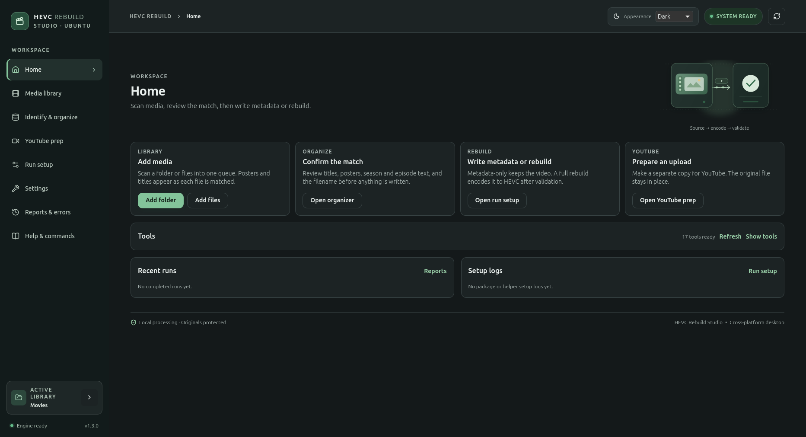
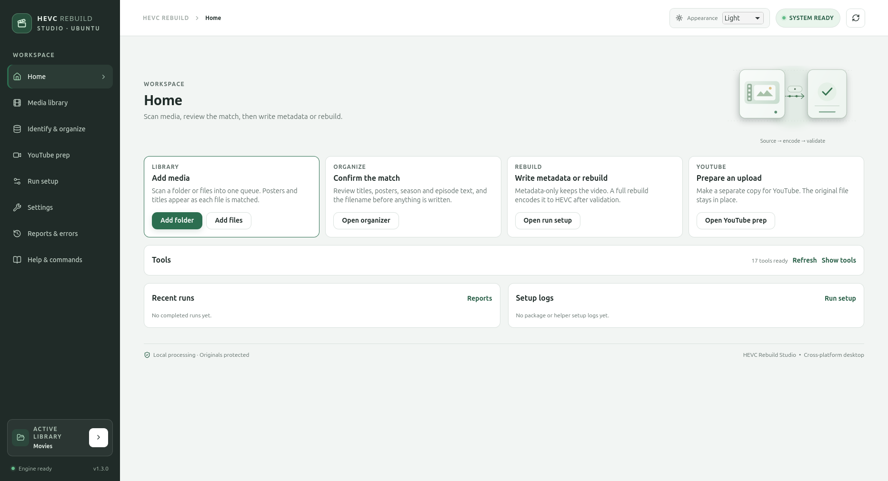
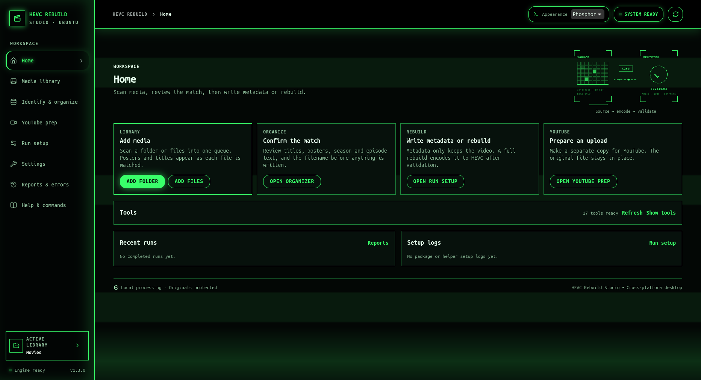
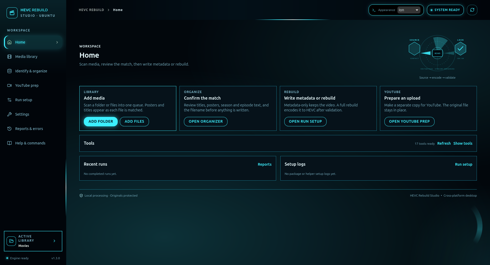
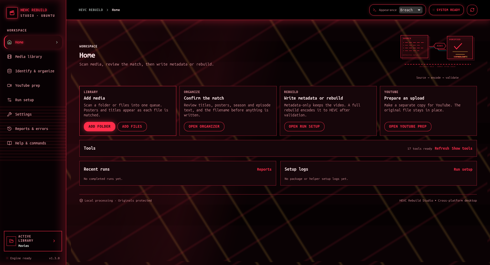

#  HEVC Rebuild Studio

<p align="center">
  <a href="https://github.com/ImYourBoyRoy/hevc-rebuild/actions/workflows/ci.yml"></a>
  
  
  
  <a href="LICENSE"></a>
</p>

<p align="center">
  <a href="https://github.com/ImYourBoyRoy/hevc-rebuild/releases">Releases</a>
  · <a href="docs/USAGE.md">Usage</a>
  · <a href="docs/TOOLS.md">Tool setup</a>
  · <a href="docs/RELEASE.md">Release workflow</a>
  · <a href="https://github.com/ImYourBoyRoy/hevc-rebuild/issues">Issues</a>
</p>

A local-first desktop utility for shrinking video to H.265/HEVC while keeping
the rest of the media file intact. Review the plan, run a safe test, and only
replace the original after the output passes validation.

<p align="center">
  
</p>

<p align="center"><em>Native Tauri desktop preview. Linux visual evidence plus native Windows/macOS package and CLI-smoke evidence are recorded; full GUI and release acceptance remain separate gates.</em></p>

## What it is for

- Rebuild selected video tracks with CPU x265/HEVC.
- Copy audio, subtitles, attachments, chapters, and supported metadata without transcoding them.
- Create a validated metadata-only MKV without re-encoding video.
- Review filenames, titles, posters, TV episodes, and output destinations before writing.
- Prepare a separate YouTube copy without changing the source.
- Use the same local workflows through the GUI, CLI, or stdio MCP server.

## Quick start

### Desktop app

The repository is pre-release and does not have public installers yet. Build
the Tauri app on the host where you intend to run it:

```bash
cd desktop
pnpm install --frozen-lockfile
pnpm tauri dev
```

The desktop build needs Python 3 plus FFmpeg/FFprobe, MediaInfo, and MKVToolNix
for the current media engine. See [tool setup](docs/TOOLS.md) and the [platform
support contract](docs/PLATFORM-SUPPORT.md).

### Standalone engine

Run a read-only environment check first, then inspect a library:

```bash
python3 -m hevc_rebuild --setup-only --no-dependency-repair
python3 -m hevc_rebuild "/path/to/Movies" --recursive --info-only
```

For the safest first run, use **Check only**, then a **Short test**, then a
reviewed **Full rebuild**. The GUI exposes these modes in the Run setup screen.

### Installed executable

The packaged executable exposes the same engine and JSON actions:

```bash
hevc-rebuild-studio cli "/path/to/Movies" --recursive --info-only
hevc-rebuild-studio json environment
hevc-rebuild-studio json scan --root "/path/to/Movies" --recursive
```

See [USAGE.md](docs/USAGE.md) for GUI, CLI, MCP, output, and recovery workflows.

## Core modes

| Mode | Result |
| --- | --- |
| **Check only** | Reads the media and reports compatibility. Writes no output. |
| **Metadata-only MKV** | Creates a new MKV without re-encoding video. |
| **Short test** | Produces a bounded test encode before a full run. |
| **Full rebuild** | Encodes selected video tracks to HEVC and validates the result. |
| **YouTube prep** | Creates a separate upload copy and leaves the source in place. |

## Safety and privacy

- Originals stay untouched until the replacement passes validation.
- Existing destinations are rejected; the app does not silently overwrite files.
- Failed late-stage outputs remain clearly marked as `.error.mkv` plus `.error.log`.
- Media processing, queue state, reports, and credentials stay local unless you explicitly use a public metadata lookup.
- Provider lookups send only the reviewed/cleaned title needed for the search; media files, paths, and video bytes are not uploaded.

## Themes

Choose Light, Dark, Phosphor, Ion, or Breach from the app's global appearance
control. These captures were made from the native app after it reached
`SYSTEM READY`, using isolated profiles so existing user settings were not
changed.

<table>
  <tr>
    <td align="center"><strong>Light</strong><br></td>
    <td align="center"><strong>Dark</strong><br></td>
  </tr>
  <tr>
    <td align="center"><strong>Phosphor</strong><br></td>
    <td align="center"><strong>Ion</strong><br></td>
  </tr>
  <tr>
    <td align="center"><strong>Breach</strong><br></td>
    <td></td>
  </tr>
</table>

## Installers and updates

The release configuration is prepared for:

| Host | Published target |
| --- | --- |
| Windows x64 | NSIS `setup.exe` — no MSI |
| macOS Intel / Apple Silicon | `.dmg` / `.app` |
| Linux x64 | AppImage and `.deb` |

Release-only Tauri updater artifacts are signed and published with
`latest.json`. The application checks for updates, shows release notes, asks
before installing, blocks updates during active work, and restarts after a
successful install. Linux `.deb` installations remain package-manager managed.

The workflows are prepared, but the first source push, GitHub secrets, clean
installer installation, native GUI walkthroughs, Apple Silicon, signing,
notarization, and live updater installation are still release gates. See
[platform evidence](docs/PLATFORM-SUPPORT.md) and [RELEASE.md](docs/RELEASE.md).

## Documentation

| Need | Read |
| --- | --- |
| Human workflows and modes | [docs/USAGE.md](docs/USAGE.md) |
| FFmpeg, MediaInfo, MKVToolNix, and host setup | [docs/TOOLS.md](docs/TOOLS.md) |
| Linux, Windows, and macOS contract | [docs/PLATFORM-SUPPORT.md](docs/PLATFORM-SUPPORT.md) |
| CI, installers, updater, and release secrets | [docs/RELEASE.md](docs/RELEASE.md) |
| Repository map and protected paths | [docs/PROJECT-STRUCTURE.md](docs/PROJECT-STRUCTURE.md) |
| Troubleshooting and support | [docs/SUPPORT.md](docs/SUPPORT.md) |
| Rust/Python ownership and migration | [python-rust-convert.md](python-rust-convert.md) |
| Architecture and implementation notes | [TECHNICAL.md](TECHNICAL.md) · [RUST_MIGRATION.md](RUST_MIGRATION.md) |
| Validation evidence and open gates | [REVIEW.md](REVIEW.md) |

## Development and validation

Use the pinned Node/pnpm versions from `.nvmrc` and `package.json`.

```bash
# Python engine and safety tests
python3 -m unittest discover -s tests -q

# Svelte/Tauri frontend
cd desktop
pnpm install --frozen-lockfile
pnpm check
pnpm check:tsgo
pnpm build
pnpm test:metadata-matching

# Native Rust boundary
cd src-tauri
cargo fmt --all -- --check
cargo test --locked --lib
cargo check --locked --bin hevc-rebuild-studio
```

Build a host-native installer with `pnpm tauri build` from `desktop/`. Release
artifacts are produced by GitHub Actions from a version tag; local development
does not publish or upload anything.

## Project layout

```text
App/                 local cross-platform artifact drop; keep it at the repository root
desktop/             Tauri 2 + Svelte desktop application
desktop/src-tauri/   Rust native boundary and packaging configuration
hevc_rebuild/        Python compatibility engine and direct CLI
tests/               Python behavior and safety tests
docs/                human usage, platform, release, and support guides
```

See [PROJECT-STRUCTURE.md](docs/PROJECT-STRUCTURE.md) before moving files or
adding a new runtime path.

## License and maintainer

Licensed under [PolyForm Noncommercial 1.0.0](LICENSE). Commercial use requires
a separate license. Maintained by [Roy Dawson IV](https://github.com/imyourboyroy).
