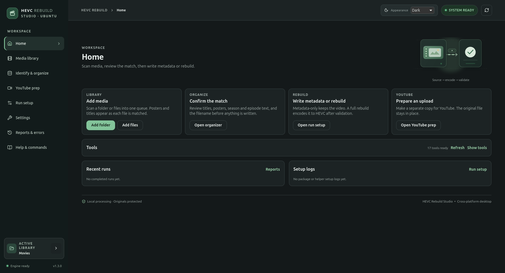
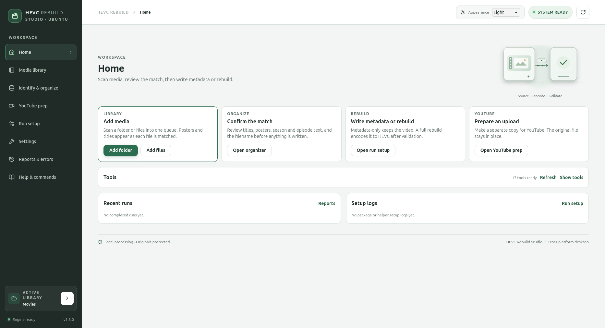
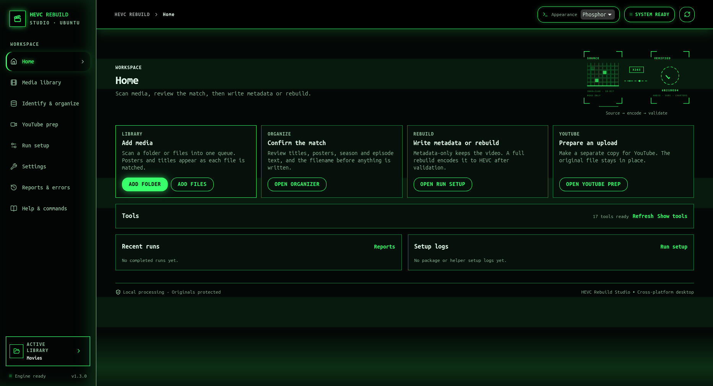
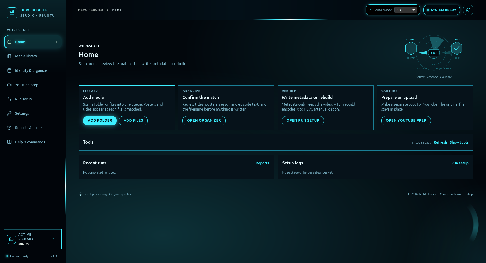
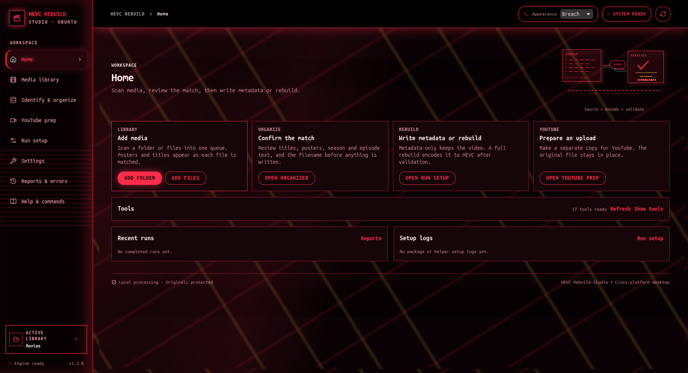

#  HEVC Rebuild Studio

<p align="center">
  <a href="https://github.com/ImYourBoyRoy/hevc-rebuild/actions/workflows/ci.yml"></a>
  
  
  
  <a href="LICENSE"></a>
</p>

<p align="center">
  <a href="https://github.com/ImYourBoyRoy/hevc-rebuild/releases">Releases</a>
  · <a href="docs/USAGE.md">Usage</a>
  · <a href="docs/TOOLS.md">Tool setup</a>
  · <a href="docs/RELEASE.md">Release workflow</a>
  · <a href="https://github.com/ImYourBoyRoy/hevc-rebuild/issues">Issues</a>
</p>

A local-first desktop utility for shrinking video to H.265/HEVC while keeping
the rest of the media file intact. Review the plan, run a safe test, and only
replace the original after the output passes validation.

<p align="center">
  
</p>

<p align="center"><em>Native Tauri desktop app. v1.4.1 continues the Rust-only desktop migration; clean-install, full GUI, real-media, and live-update acceptance remain separate gates.</em></p>

## What it is for

- Rebuild selected video tracks with CPU x265/HEVC.
- Copy audio, subtitles, attachments, chapters, and supported metadata without transcoding them.
- Create a validated metadata-only MKV without re-encoding video.
- Review filenames, titles, posters, TV episodes, and output destinations before writing.
- Prepare a separate YouTube copy without changing the source.
- Use the same local workflows through the GUI, CLI, or stdio MCP server.

## Quick start

### Desktop app

Download the latest published release for a Windows NSIS installer, macOS DMG, or Linux AppImage/deb. To build the Tauri app from source on the host where you intend to run it:

```bash
cd desktop
pnpm install --frozen-lockfile
pnpm tauri dev
```

The desktop build needs FFmpeg/FFprobe, MediaInfo, and MKVToolNix. Check only,
integrity, Metadata-only MKV, short tests, full rebuilds, and YouTube upload
preparation run through the native Rust engine. See [tool setup](docs/TOOLS.md)
and the [platform support contract](docs/PLATFORM-SUPPORT.md).

### Native executable

Run a read-only environment check first, then inspect a library:

```bash
hevc-rebuild-studio json environment
hevc-rebuild-studio cli "/path/to/Movies" --recursive --info-only
```

For the safest first run, use **Check only**, then a **Short test**, then a
reviewed **Full rebuild**. The GUI, CLI, and MCP server use the same native Rust
run coordinators and confirmation rules.

### Installed executable

The packaged executable exposes the same native workflow and JSON actions:

```bash
hevc-rebuild-studio cli "/path/to/Movies" --recursive --info-only
hevc-rebuild-studio json environment
hevc-rebuild-studio json scan --root "/path/to/Movies" --recursive
```

See [USAGE.md](docs/USAGE.md) for GUI, CLI, MCP, output, and recovery workflows.

### Native walkthrough control

Maintainers can launch a debug or release binary with
`HEVC_REBUILD_AGENT_CONTROL=1` to expose a private local control channel for
real Tauri-window walkthroughs. It supports bounded state/snapshot queries and
keyboard dispatch without a browser harness:

```bash
# Development window: start the Tauri supervisor so Vite and its 127.0.0.1
# devUrl are launched together. Keep recyclable state beside this checkout.
cd desktop
export HEVC_REBUILD_AGENT_CONTROL=1
export HEVC_REBUILD_PORTABLE_DATA_DIR="$PWD/../.native-smoke/manual"
pnpm tauri dev

# In another terminal, from the repository root:
cd ..
./desktop/src-tauri/target/debug/hevc-rebuild-studio agent-control state
./desktop/src-tauri/target/debug/hevc-rebuild-studio agent-control snapshot
./desktop/src-tauri/target/debug/hevc-rebuild-studio agent-control press Alt+4

# Installed/release binary:
HEVC_REBUILD_AGENT_CONTROL=1 hevc-rebuild-studio
hevc-rebuild-studio agent-control snapshot
hevc-rebuild-studio agent-control press Alt+4
```

The development configuration deliberately uses `http://127.0.0.1:1420`,
matching Vite's bind address. Do not launch a raw debug binary with
`cargo run` and expect it to start Vite; use `pnpm tauri dev` for development
or a bundled/static Tauri build for release-style testing. The optional
`HEVC_REBUILD_PORTABLE_DATA_DIR` keeps the endpoint, settings, logs, and cache
in a selected project-local profile; without it, normal OS app-state locations
are used.

The channel is disabled by default, has no shell execution, and is not a
runtime dependency. Endpoint cleanup is ownership-aware, so an older
development process cannot remove a newer process's project-local endpoint.
Native file pickers, OS drag/drop, screen-reader output,
close/reopen, and stop-now during a live encode still require direct native
acceptance evidence.

## Core modes

| Mode | Result |
| --- | --- |
| **Check only** | Reads the media and reports compatibility. Writes no output. |
| **Metadata-only MKV** | Creates a new MKV without re-encoding video. |
| **Short test** | Produces a bounded test encode before a full run. |
| **Full rebuild** | Encodes selected video tracks to HEVC and validates the result. |
| **YouTube prep** | Creates a separate upload copy and leaves the source in place. **Upscale** lifts 720p/1080p sources to 1440p or 4K so YouTube gives them its higher bitrate tier; **Optimize** keeps 1440p/4K/8K sources at their size, stream-copies healthy video with YouTube container tags (faststart, `hvc1`, BT.709 backfill), and re-encodes only oversized files when a sampled SSIM check passes. SDR codec (H.264 default or HEVC), encoder preset, shrink policy, and quality check are selectable. HDR10+ is preserved on re-encode via the same `hdr10plus_tool` inject path as rebuilds when the helper is installed; otherwise per-file loss consent is required. |
| **HDR10+ preserve** | Autonomous: encode-time `dhdr10-info` when libx265 has `HDR10_PLUS`, otherwise post-encode inject + remux, then verify. Work dirs default to a source-adjacent `.hevc-rebuild-work/` folder; `HEVC_REBUILD_WORK_ROOT` overrides it, with app-state fallback if the source folder is not writable. Never uses `/tmp`. See [TOOLS.md](docs/TOOLS.md). |

## Shared settings and work-directory discovery

The GUI, CLI, and MCP server use the same native settings and run argument
contract. The `paths.work_root` setting defaults to `auto`, which resolves
independently for each source to `<source-folder>/.hevc-rebuild-work/`. An
absolute `paths.work_root` selects one shared scratch folder. The GUI exposes
the setting under **Settings → Temporary work storage**.

Every client can inspect the actual source-specific resolution before a run:

```bash
hevc-rebuild-studio json work-directory --root "/path/to/Movies/Film.mkv"
hevc-rebuild-studio json work-directory --root "/path/to/Movies" --work-root "/fast/work"
```

MCP clients use `inspect_work_directory`; `start_media_run` accepts the same
optional `work_root` override. Direct CLI rebuild, metadata, and YouTube runs
accept `--work-root auto` or an absolute path. `HEVC_REBUILD_WORK_ROOT` remains
an explicit process-level override and takes precedence over the saved setting.
If an automatic source-adjacent folder cannot be created, the app-state
`work/` folder is used and reported as the fallback. No client silently uses
`/tmp`.

## Safety and privacy

- Originals stay untouched until the replacement passes validation.
- Existing destinations are rejected; the app does not silently overwrite files.
- Failed late-stage outputs remain clearly marked as `.error.mkv` plus `.error.log`.
- Media processing, queue state, reports, and credentials stay local unless you explicitly use a public metadata lookup.
- Provider lookups send only the reviewed/cleaned title needed for the search; media files, paths, and video bytes are not uploaded.

## Themes

Choose Light, Dark, Phosphor, Ion, or Breach from the app's global appearance
control. These captures were made from the native app after it reached
`SYSTEM READY`, using isolated profiles so existing user settings were not
changed.

<table>
  <tr>
    <td align="center"><strong>Light</strong><br></td>
    <td align="center"><strong>Dark</strong><br></td>
  </tr>
  <tr>
    <td align="center"><strong>Phosphor</strong><br></td>
    <td align="center"><strong>Ion</strong><br></td>
  </tr>
  <tr>
    <td align="center"><strong>Breach</strong><br></td>
    <td></td>
  </tr>
</table>

## Installers and updates

The release configuration is prepared for:

| Host | Published target |
| --- | --- |
| Windows x64 | NSIS `setup.exe` — no MSI |
| macOS Intel / Apple Silicon | `.dmg` / `.app` |
| Linux x64 | AppImage and `.deb` |

Release-only Tauri updater artifacts are signed and published with
`latest.json`. The application checks for updates, shows release notes, asks
before installing, blocks updates during active work, and restarts after a
successful install. Linux `.deb` installations remain package-manager managed.

The first public release passed its GitHub Actions source, cross-platform
compile, package, signature, and updater-manifest gates. Clean installer
installation, native GUI walkthroughs, real-media runs, Apple signing or
notarization, and a live installed-app update remain separate acceptance
checks. See [platform evidence](docs/PLATFORM-SUPPORT.md) and
[RELEASE.md](docs/RELEASE.md).

## Documentation

| Need | Read |
| --- | --- |
| Human workflows and modes | [docs/USAGE.md](docs/USAGE.md) |
| FFmpeg, MediaInfo, MKVToolNix, and host setup | [docs/TOOLS.md](docs/TOOLS.md) |
| Linux, Windows, and macOS contract | [docs/PLATFORM-SUPPORT.md](docs/PLATFORM-SUPPORT.md) |
| CI, installers, updater, and release secrets | [docs/RELEASE.md](docs/RELEASE.md) |
| Repository map and protected paths | [docs/PROJECT-STRUCTURE.md](docs/PROJECT-STRUCTURE.md) |
| Troubleshooting and support | [docs/SUPPORT.md](docs/SUPPORT.md) |
| UI source inventory and task budgets | [docs/interaction-map.md](docs/interaction-map.md) · [interaction-map tool](tools/interaction-map.mjs) |
| UI state waterfalls and minimum click formulas | [docs/interaction-waterfall.md](docs/interaction-waterfall.md) · [waterfall config](docs/interaction-waterfalls.json) · [waterfall tool](tools/interaction-waterfall.mjs) |
| Native architecture and retirement record | [python-rust-convert.md](docs/maintainer/python-rust-convert.md) |
| Architecture and implementation notes | [TECHNICAL.md](docs/maintainer/TECHNICAL.md) · [RUST_MIGRATION.md](docs/maintainer/RUST_MIGRATION.md) |
| Validation evidence and open gates | [REVIEW.md](docs/maintainer/REVIEW.md) |

## Development and validation

Use the pinned Node/pnpm versions from `.nvmrc` and `package.json`.

```bash
# Svelte/Tauri frontend
cd desktop
pnpm install --frozen-lockfile
pnpm check
pnpm check:tsgo
pnpm build
pnpm test:metadata-matching

# Source-derived UI click-flow map (repository root package scripts)
pnpm --dir .. interaction-map
pnpm --dir .. interaction-map:check

# State-oriented multiflow waterfall (app clicks + native picker x + automatic steps)
pnpm --dir .. interaction-waterfall
pnpm --dir .. interaction-waterfall:check

# Native Rust boundary
cd src-tauri
cargo fmt --all -- --check
cargo test --locked --lib
cargo clippy --all-targets --locked -- -D warnings
cargo check --locked --bin hevc-rebuild-studio
```

Build a host-native executable with `pnpm tauri build` from `desktop/`, or use
the Linux source installer at `./install.sh`. Release artifacts are produced
by GitHub Actions from a version tag; local development does not publish or
upload anything.

## Project layout

```text
App/                 local cross-platform artifact drop; keep it at the repository root
desktop/             Tauri 2 + Svelte desktop application
desktop/src-tauri/   Rust native boundary, run coordinators, and packaging configuration
desktop/tests/       Browser/component contract tests
docs/                human usage, platform, release, and support guides
docs/maintainer/     architecture, validation, dependency, and migration notes
```

See [PROJECT-STRUCTURE.md](docs/PROJECT-STRUCTURE.md) before moving files or
adding a new runtime path. Local agent/session notes are intentionally kept
outside the public source tree.

## License and maintainer

Licensed under [PolyForm Noncommercial 1.0.0](LICENSE). Commercial use requires
a separate license. Maintained by [Roy Dawson IV](https://github.com/imyourboyroy).
